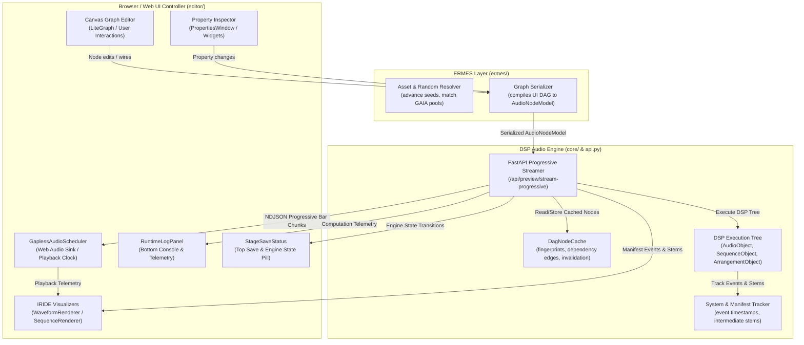
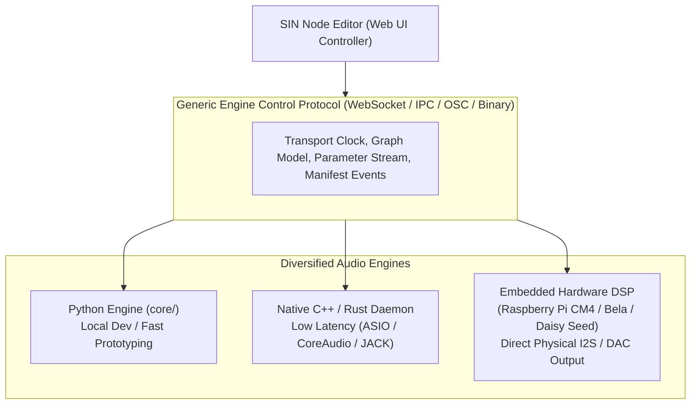

# SIN Audio Engine Architecture, UI Synchronization & Hardware Roadmap

> **Authoritative Architectural Reference & Memory Document**  
> Documents the design, dataflow, and synchronization contracts between the **SIN Audio Engine**, the **ERMES Translation Layer**, and the **Web UI Controller**, including hot-swapping mechanics, state indicators, and the roadmap for hardware/native audio engines.

---

## 1. Executive Summary & Core Mandate

The fundamental architectural principle of SIN is:

> **The backend audio engine is the sole authority for all audio synthesis, DSP operations, time-stretching, sequencing, stem mixing, and delivery. The browser/Web UI is strictly a dumb controller, parameter editor, and transport sink.**

### Key Non-Negotiables:
1. **Zero Browser DSP:** No audio processing, sound generation, time-stretching (Rubber Band), or sample manipulation happens inside the browser's JavaScript thread.
2. **Web Audio as an Output Sink:** Web Audio API (`AudioContext`, `AudioBufferSourceNode`) is used solely as a progressive buffer player and playback clock for live auditioning in the browser.
3. **Pluggable & Hardware-Ready:** The protocol between the UI and engine must remain transport-agnostic so the exact same web UI can drive:
   - The current local Python FastAPI engine (`core/`).
   - A compiled native C++ / Rust engine daemon (ASIO, CoreAudio, JACK).
   - An embedded hardware box (Raspberry Pi CM4, Bela, Electrosmith Daisy Seed) with physical DAC outputs, bypassing the browser entirely for audio output.

---

## 2. Current Architecture: Engine <-> Web UI Interaction Loop

### 2.1 Complete System Architecture



---

### 2.2 The Progressive RAM Preview Protocol (`/api/preview/stream-progressive`)

Rather than forcing the user to wait for an entire 8- or 16-bar track to render before hearing sound, the engine renders and streams audio **progressively on a bar-by-bar basis** over an NDJSON HTTP stream:

1. **Graph Compilation:**
   - The UI identifies the audition target (Master Track or isolated node) via `resolveMainPreviewNode(graph)`.
   - Dynamic asset pools (`asset_filter`) and random modifiers (`random`) are resolved in ERMES with seeds advanced according to refresh mode (`global`, `local`, `parent`).
   - The graph subtree is compiled into an invariant `AudioNodeModel` payload.

2. **Backend Execution:**
   - FastAPI endpoint `/api/preview/stream-progressive` initializes `System(bpm=payload.bpm, render_mode="preview")`.
   - The root object (`MasterTrackObject`, `ArrangementObject`, or `SequenceObject`) renders the audio DAG.
   - Nodes query `GLOBAL_DAG_CACHE.get(node_id, fingerprint)`:
     - **Cache Hit:** Reuses previously computed float32 audio arrays and restored manifest states in microseconds.
     - **Cache Miss:** Runs full DSP (sample loading, rubberband time-stretch, step sequencing, chain effects), registers DAG dependency edges via `GLOBAL_DAG_CACHE.register_edge(parent_id, child_id)`, and stores the output in `GLOBAL_DAG_CACHE`.
   - Intermediate stem audio arrays are captured for all child tracks and arrangements.
   - Event trigger timestamps (start time, duration, sequence origin) are recorded into `system.manifest`.

3. **NDJSON Chunk Streaming:**
   The backend slices the final audio array into bar-sized chunks (`samples_per_bar = sample_rate * seconds_per_bar`) and yields them immediately as JSON lines:
   ```json
   {"chunk_type": "bar", "bar_index": 0, "total_bars": 8, "bpm": 140.0, "start_seconds": 0.0, "duration_seconds": 1.714, "audio_base64": "...", "peaks": [...], "manifest": {...}}
   ```
   Followed by bars 1, 2, ..., N, and finally:
   ```json
   {"chunk_type": "complete", "total_duration": 13.714, "status": "success", "audio_url": "/api/preview/stream/export_1"}
   ```

4. **Frontend Ingestion & Scheduling (`GaplessAudioScheduler`):**
   - **Bar 0 Arrival:** Decoded via `ctx.decodeAudioData`. If autoplay is requested, playback starts immediately (`time-to-first-sound < 150ms`).
   - **Subsequent Bars:** Appended to `barBuffers` map and stitched sample-accurately into the Web Audio timeline using double-buffered `AudioBufferSourceNode` scheduling with lookahead.
   - **Waveform & Telemetry:** Full audio buffer is accumulated into `activeRamPreviewBuffer` for the master waveform, while `distributeWorkspaceManifest` distributes stem buffers and event markers to individual nodes on the canvas.

---

### 2.3 Incremental Rendering & Invalidation (`DagNodeCache`)

The backend cache in `core/dag_cache.py` prevents redundant recalculations:

- **Node Fingerprint:** Produced via SHA-1 hash of the node's sanitized configuration parameters (excluding children and ephemeral IDs).
- **DAG Edge Registration:** When node $P$ renders child $C$, `GLOBAL_DAG_CACHE.register_edge(parent_id=P, child_id=C)` registers both forward ($P \to C$) and reverse ($C \to P$) dependencies.
- **Downstream Invalidation:**
  - When child node $C$ is modified in the UI, `GLOBAL_DAG_CACHE.invalidate_downstream(C)` traverses `_reverse_dependencies` and evicts $C$, its parent $P$, and all downstream consumers (e.g., Drum Bus $\to$ Master Track).
  - Unrelated sibling branches (e.g., Bass Bus) remain cached and are reused instantly.
- **Full Refresh Invalidation:**
  - When the user presses the global **Refresh** button (`↻`), `/api/preview/invalidate` is called with `{ node_ids: [] }`, which calls `GLOBAL_DAG_CACHE.clear()` and `RAM_PREVIEW_STORE.clear()`, forcing a complete recalculation of all dynamic pools, sequences, and randomizers.

---

### 2.4 Transport Mechanics: Play vs. Refresh

| Action | User Intent | UI Behavior | Engine Behavior |
| :--- | :--- | :--- | :--- |
| **Play (`Space` / Global Play)** | Audition / resume playback | Starts `globalAudioScheduler.play()`. If graph is invalidated or first-generation, triggers preview first. | Resumes active buffer or renders dirty nodes. Preserves active seeds and pool choices. |
| **Stop (`Space` / Global Pause)** | Pause playback | Pauses scheduler and resets transport telemetry. | Engine remains idle; buffers remain cached in memory. |
| **Refresh (`↻` Button)** | Re-roll generative elements | Immediately stops playback, clears all client stem buffers, marks graph invalidated. | Fully purges `GLOBAL_DAG_CACHE` and RAM store, advances global seeds/pools, re-renders clean audio in background (`autoplay=false`). |
| **Hot Swap (Slider / Parameter)** | Live sound tweaking while playing | Playback **continues uninterrupted**; debounces 150ms then triggers background stream. | Incremental downstream invalidation; streams new bar chunks; scheduler seamlessly crossfades into new audio. |

---

## 3. Web Audio Delivery & Strudel.cc Inspiration

### 3.1 Lessons from Strudel.cc
Strudel (the Web-based live-coding environment based on TidalCycles) achieves legendary musical tightness by adhering to three principles:
1. **Separation of Cycle Pattern and Clock:** Strudel computes fractional cycle time (`cps` - cycles per second) independently of the browser DOM or audio hardware clock.
2. **Lookahead Scheduling ("The Web Audio Clock Rule"):** JavaScript `setTimeout` and `requestAnimationFrame` are prone to jitter (up to 50ms under load). Audio must **never** be triggered directly inside a JS timer. Instead, a fast JS timer (every 25–50ms) schedules events ahead into the future on the hardware-accurate `audioContext.currentTime` timeline (typically 100–200ms lead time).
3. **Immutable Event Bundles:** Patterns yield immutable temporal events `[time, duration, value]` that the audio sink consumes without needing to understand the pattern generation logic.

### 3.2 How SIN Implements and Improves This
- **Backend as Pattern & DSP Authority:** While Strudel evaluates mini-notation in JavaScript, SIN offloads all generation, DSP synthesis, sample processing, and Rubber Band time-stretching to the Python/Native engine.
- **Sample-Accurate Chunk Stitching:** `GaplessAudioScheduler` uses `audioContext.currentTime` with dynamic lead latency to stitch discrete bar WAV chunks without clicks or gaps.
- **Manifest Event Stream:** SIN’s backend `System.manifest` emits timestamped events `[time, duration, node_id]` identical to Strudel's event bundles. These events drive the IRIDE canvas visualizers (`SequenceRenderer`, `WaveformRenderer`) in sample-accurate synchrony with the audio sink.

---

## 4. Web UI <-> Engine Synchronization & State Machine

### 4.1 Engine State Machine

The interaction between the canvas editor and the backend engine follows an explicit finite state machine:

```text
[IDLE_SYNCED] ──(Param Edit / Wire)──> [DIRTY_PENDING] (150ms debounce)
      │                                       │
      │                                       v
      │                                [INVALIDATING] (evict DAG cache)
      │                                       │
      │                                       v
      │                                [DSP_RENDERING] (backend compilation)
      │                                       │
      │                                       v
      │                                [STREAMING_CHUNKS] (NDJSON bar stream)
      │                                       │
      │                                       v
      └─────────────────────────────── [INGESTING_BUFFER]
                                              │
                                              v
                                        [IDLE_SYNCED]
```

#### Detailed State Definitions:

1. **`IDLE_SYNCED`:**
   - All parameters in UI match the cached audio buffer in `globalAudioScheduler`.
   - No pending requests; transport is ready for instant play/stop with zero latency.
2. **`DIRTY_PENDING`:**
   - User moved a slider or connected a cable while playing or paused.
   - UI buffers changed node IDs in `pendingInvalidatedNodes`.
   - 150ms debounce timer is running to allow multi-parameter adjustments without choking the engine.
3. **`INVALIDATING`:**
   - POST `/api/preview/invalidate` with `{ node_ids: [...] }` or `{ node_ids: [] }`.
   - Affected nodes and their downstream parents are evicted from cache.
4. **`DSP_RENDERING`:**
   - Backend is executing the DAG, running Rubber Band stretches, filters, or arranger loops.
5. **`STREAMING_CHUNKS`:**
   - Backend is actively streaming progressive NDJSON lines (`bar_index 0, 1, ...`).
6. **`INGESTING_BUFFER`:**
   - Audio scheduler is decoding WAV chunks and stitching them into Web Audio memory.
   - Master waveform and IRIDE node visualizers update progressively.
7. **`HOT_SWAPPING`:**
   - Special sub-state active when playback is running: audio scheduler prepares crossfade/lead swap to replace the currently playing bar with the new audio without stopping playback.
8. **`GLOBAL_REFRESHING`:**
   - Special state triggered by `↻` button: transport is halted, all caches purged, seeds advanced, full re-render running.
9. **`DESYNC_ERROR`:**
   - Network failure or DSP exception during preview calculation. Transport disabled, error logged.

---

### 4.2 UI Indicators Enhancement Strategy

To provide immediate, professional feedback on engine status and computation timings, we will enhance two existing UI components:

#### 1. Top Save & Engine Status Pill (`.stage-save-status`)
Currently located in the top-right toolbar, this pill displays project save states (`saved`, `saving`, `unsaved`). We will expand it into a dual **Stage & Engine State Monitor**:

| Engine State | Visual Indicator | Icon / Animation | Tooltip / Status Text |
| :--- | :--- | :--- | :--- |
| **`IDLE_SYNCED`** | Emerald Green (`#10b981`) | Solid circle `●` | `"Engine in sync (Ready)"` |
| **`DIRTY_PENDING`** | Cyan (`#38bdf8`) | Soft blink `◐` | `"Changes detected... (Evaluating)"` |
| **`DSP_RENDERING`** | Amber (`#f59e0b`) | Rotating spinner `↻` | `"Rendering DSP... (Node 12: Drum Bus)"` |
| **`STREAMING_CHUNKS`**| Magenta (`#ec4899`) | Pulse `◉` | `"Streaming preview: Bar 2/8 (45%)"` |
| **`HOT_SWAPPING`** | Purple (`#8b5cf6`) | Wave `≋` | `"Hot-swapping audio buffer in-flight"` |
| **`DESYNC_ERROR`** | Red (`#ef4444`) | Warning triangle `▲` | `"Engine error: Click to view console"` |

**Metrics Tooltip:** Hovering over the pill displays performance metrics:
- Last render time: `142 ms` (Cache hit: 4 nodes, Rendered: 2 nodes)
- Streaming latency: `38 ms`
- Buffer memory: `4.2 MB` (8 bars @ 44.1kHz stereo)

#### 2. Bottom Runtime Console (`RuntimeLogPanel` & `runtimeLog`)
The bottom console already logs messages via `subscribeRuntimeLog`. We will enhance it with structured **Engine Performance Telemetry**:
- **Granular Node Render Times:**
  ```text
  [DSP] Invalidation: evicting [kick-seq, drum-bus, master] (1.2 ms)
  [DSP] Render kick-seq: generated 16 steps (8.4 ms)
  [DSP] Render drum-bus: summed 3 stems + compressor (14.1 ms)
  [DSP] Total compilation: 23.7 ms | 8 bars generated
  [Stream] Bar 0/8 received (18 ms) -> Scheduler started
  ```
- **Live Computation Profiler:** When paused or playing, display the exact millisecond cost of any edited parameter.

#### 3. Node Canvas Badges & Buffered Progress
- Nodes currently support `bufferedProgress` (`0.0` to `1.0`). As chunks stream, the active preview target fills a progressive neon fill line across its top header.
- Nodes flagged with `isInvalidated` can render a subtle pulsing border to clearly indicate which parts of the DAG are dirty and awaiting compilation.

---

## 5. Future Architecture & Hardware Engine Roadmap



### 5.1 Step 1: Binary PCM Streaming (WebSocket / Raw Binary HTTP)
- **Current Limitation:** NDJSON transmits WAV chunks encoded in Base64 strings. Base64 introduces a ~33% payload size penalty and requires string encoding/decoding overhead.
- **Future Upgrade:** Replace HTTP polling/streaming with a dedicated binary WebSocket or raw HTTP chunked transfer delivering Float32/Int16 interleaved PCM frames directly into `AudioBuffer` channels, reducing latency by another 25–40%.

### 5.2 Step 2: AudioWorklet Shared Ring Buffer
- **Current Limitation:** Main-thread Web Audio scheduling is tied to browser event loops. Under intense canvas zooming or dragging, minor audio scheduling stutters can theoretically occur.
- **Future Upgrade:** Move the chunk ingestion and clocking into an `AudioWorkletNode` backed by `SharedArrayBuffer` ring buffer, matching professional DAWs in rock-solid sample accuracy.

### 5.3 Step 3: Native Daemon Engine (C++ / Rust)
- For heavy live performances, the engine can be compiled into a standalone native binary running JUCE, Rust (cpal/fundsp), or C++.
- The SIN Web UI connects over local WebSocket/IPC:
  - The UI graph is compiled to `AudioNodeModel`.
  - The native daemon receives the payload, executes the DSP in a real-time thread, and outputs directly to hardware audio interfaces (Focusrite, Universal Audio, RME) with `< 5ms` round-trip latency.
  - The browser audio sink is completely bypassed or used solely as a remote preview monitor.

### 5.4 Step 4: Standalone Hardware Engine (Embedded DSP)
- The SIN node editor can act as a **pure hardware controller** for an external physical synthesizer or groovebox:
  - **Embedded Linux (Raspberry Pi CM4, Bela):** Runs the headless CLI/daemon, outputting multi-channel audio through high-end I2S DACs (e.g., Burr-Brown PCM5122).
  - **Microcontroller DSP (Electrosmith Daisy Seed, Teensy 4.1):** Receives serialized graph patches and parameter MIDI/OSC commands over USB High-Speed, executing step sequencing and synthesis directly on bare-metal hardware.
  - The browser UI handles high-level wire patching, visual waveform display, and library management, while the hardware delivers the sound with zero operating system jitter.

---

## 6. Summary Checklist for Future Implementation

When implementation resumes on the engine & sync infrastructure, the planned roadmap consists of:

1. [x] **UI State Machine Integration:** Hooked `setPreviewCalculatingState` and `node-property-changed` into a unified `EngineSyncManager` that updates `.engine-sync-status` and node badges.
2. [x] **Telemetry Profiler in Runtime Console:** Surfaced backend millisecond timings (`runtime_log` entries) into the bottom `RuntimeLogPanel` with category filters and live metrics bar.
3. [x] **Binary Streaming Protocol:** Implemented binary chunk framing (`SINB` header: magic + meta_len + audio_len) for `/api/preview/stream-progressive` to eliminate base64 CPU overhead.
4. [x] **AudioWorklet Ring Buffer Scheduler:** Upgraded `GaplessAudioScheduler` with an `AudioWorkletNode` ring buffer processor for thread isolation with seamless fallback.
5. [ ] **Hardware Abstraction Layer (HAL):** Define the abstract `AudioOutputDevice` interface in `core/` to pave the way for native ASIO/JACK/ALSA output options.
