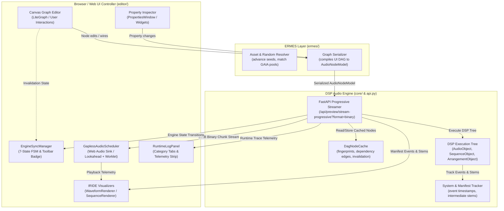
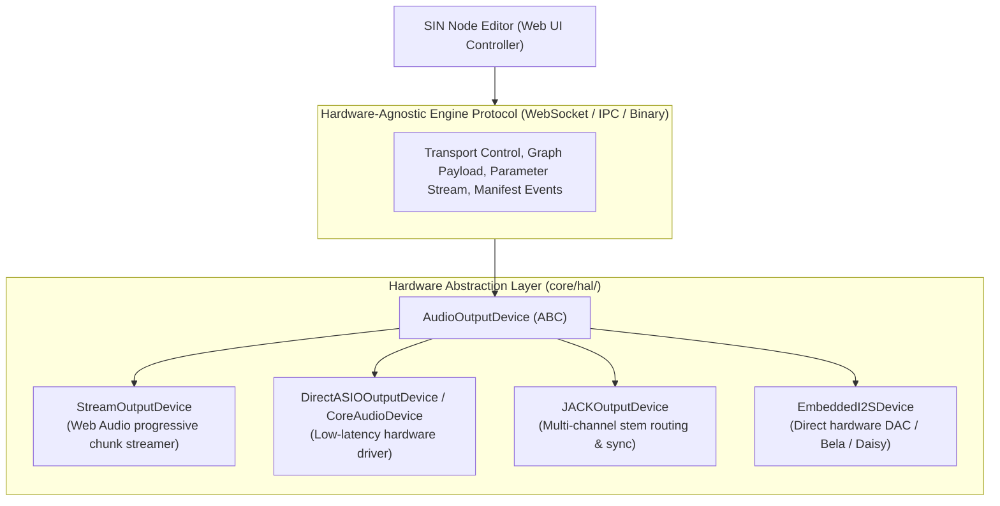

# SIN Audio Engine Architecture, UI Synchronization & Hardware Roadmap

> **Authoritative Architectural Reference & Memory Document**  
> Documents the complete design, dataflow, and synchronization contracts between the **SIN Audio Engine**, the **ERMES Translation Layer**, and the **Web UI Controller**, including hot-swapping mechanics, binary streaming protocol, state indicators, audio scheduler internals, and the technical specification for extending the engine into a Hardware Abstraction Layer (HAL) and native/embedded DSP runtimes.

---

## 1. Executive Summary & Core Mandate

The foundational architectural principle of SIN is:

> **The backend audio engine is the sole authority for all audio synthesis, DSP operations, time-stretching, sequencing, stem mixing, and delivery. The browser/Web UI is strictly a dumb controller, parameter editor, and transport sink.**

### Key Non-Negotiables:
1. **Zero Browser DSP:** No audio processing, sound generation, time-stretching (Rubber Band), filtering, or sample manipulation happens inside the browser's JavaScript thread.
2. **Web Audio as an Output Sink:** The Web Audio API (`AudioContext`, `AudioBufferSourceNode`, `AudioWorkletNode`) is used solely as a progressive buffer player and playback clock for auditioning inside the web application.
3. **Transport-Agnostic Engine Protocol:** The interface between the UI and engine is decoupled from the browser environment so the exact same web UI can drive:
   - The current local Python FastAPI engine (`core/` & `api.py`).
   - A compiled native C++ / Rust engine daemon (ASIO, CoreAudio, JACK).
   - An embedded hardware box (Raspberry Pi CM4, Bela, Electrosmith Daisy Seed) with physical DAC outputs, bypassing the browser entirely for audio output.

---

## 2. Current Architecture: Engine <-> Web UI Interaction Loop

### 2.1 Complete System Architecture



---

### 2.2 The Progressive RAM Preview Protocol (`/api/preview/stream-progressive`)

Rather than forcing the user to wait for an entire 8- or 16-bar track to render before hearing sound, the engine renders and streams audio **progressively on a bar-by-bar basis** over a high-performance HTTP stream:

1. **Graph Compilation:**
   - The UI identifies the audition target (Master Track or isolated node) via `resolveMainPreviewNode(graph)`.
   - Dynamic asset pools (`asset_filter`) and random modifiers (`random`) are resolved in ERMES with seeds advanced according to refresh mode (`global`, `local`, `parent`).
   - The graph subtree is compiled into an invariant `AudioNodeModel` payload.

2. **Backend Execution:**
   - FastAPI endpoint `/api/preview/stream-progressive` initializes `System(bpm=payload.bpm, render_mode="preview")`.
   - The root object (`MasterTrackObject`, `ArrangementObject`, or `SequenceObject`) renders the audio DAG.
   - Nodes query `GLOBAL_DAG_CACHE.get(node_id, fingerprint)`:
     - **Cache Hit:** Reuses previously computed float32 audio arrays and restored manifest states in microseconds.
     - **Cache Miss:** Runs full DSP (sample loading, rubberband time-stretch, step sequencing, chain effects), registers DAG dependency edges via `GLOBAL_DAG_CACHE.register_edge(parent_id, child_id)`, and stores the output in `GLOBAL_DAG_CACHE`.
   - Intermediate stem audio arrays are captured for all child tracks and arrangements.
   - Event trigger timestamps (start time, duration, sequence origin) are recorded into `system.manifest`.

3. **Binary Framing Protocol (`SINB`):**
   When `format=binary` is specified (default), each progressive chunk is packed into a 12-byte binary framed block:
   ```text
   +-----------------------+-----------------------+-----------------------+
   |   Magic (4 bytes)     |  meta_len (uint32 BE)  |  audio_len (uint32 BE) |
   |      "SINB"           |      4 bytes          |      4 bytes          |
   +-----------------------+-----------------------+-----------------------+
   |                  JSON Metadata (UTF-8, meta_len bytes)                |
   +-----------------------------------------------------------------------+
   |                  Raw Binary WAV PCM Data (audio_len bytes)             |
   +-----------------------------------------------------------------------+
   ```
   - **Bar Chunks:** `audio_len > 0`. Transmits sliced bar WAV bytes along with bar index, total bars, tempo, and manifest.
   - **Completion Chunk:** `audio_len == 0`. Transmits final metrics (`render_ms`, `total_duration`), full audio URL, and runtime logs.
   - **Zero-Copy Parsing:** The frontend slices `audioBytes` with `DataView` and passes raw ArrayBuffer directly to Web Audio `AudioContext.decodeAudioData()`, completely bypassing Base64 string decoding and saving ~33% bandwidth.
   - **NDJSON Fallback:** For backwards compatibility, omit `?format=binary` to stream newline-delimited JSON chunks with Base64 payloads.

4. **Frontend Ingestion & Scheduling (`GaplessAudioScheduler`):**
   - **Bar 0 Arrival:** Decoded via `ctx.decodeAudioData`. If autoplay is requested, playback starts immediately (`time-to-first-sound < 150ms`).
   - **Subsequent Bars:** Appended to `barBuffers` map and stitched sample-accurately into the Web Audio timeline using lookahead scheduling.
   - **Waveform & Telemetry:** Full audio buffer is merged into `activeRamPreviewBuffer` for the master waveform, while `distributeWorkspaceManifest` distributes stem buffers and event markers to individual canvas nodes.

---

### 2.3 Incremental Rendering & Invalidation (`DagNodeCache`)

The backend cache in `core/dag_cache.py` prevents redundant recalculations:

- **Node Fingerprint:** Produced via SHA-1 hash of the node's sanitized configuration parameters (excluding children and ephemeral IDs).
- **DAG Edge Registration:** When node $P$ renders child $C$, `GLOBAL_DAG_CACHE.register_edge(parent_id=P, child_id=C)` registers both forward ($P \to C$) and reverse ($C \to P$) dependencies.
- **Downstream Invalidation:**
  - When child node $C$ is modified in the UI, `GLOBAL_DAG_CACHE.invalidate_downstream(C)` traverses `_reverse_dependencies` and evicts $C$, its parent $P$, and all downstream consumers (e.g., Drum Bus $\to$ Master Track).
  - Unrelated sibling branches (e.g., Bass Bus) remain cached and are reused instantly.
- **Full Refresh Invalidation:**
  - When the user presses the global **Refresh** button (`↻`), `/api/preview/invalidate` is called with `{ node_ids: [] }`, which calls `GLOBAL_DAG_CACHE.clear()` and `RAM_PREVIEW_STORE.clear()`, forcing a complete recalculation of all dynamic pools, sequences, and randomizers.

---

### 2.4 Transport Mechanics: Play vs. Refresh

| Action | User Intent | UI Behavior | Engine Behavior |
| :--- | :--- | :--- | :--- |
| **Play (`Space` / Global Play)** | Audition / resume playback | Starts `globalAudioScheduler.play()`. If graph is invalidated or first-generation, triggers preview first. | Resumes active buffer or renders dirty nodes. Preserves active seeds and pool choices. |
| **Stop (`Space` / Global Pause)** | Pause playback | Pauses scheduler and resets transport telemetry. | Engine remains idle; buffers remain cached in memory. |
| **Refresh (`↻` Button)** | Re-roll generative elements | Immediately stops playback, clears client stem buffers, marks graph invalidated. | Fully purges `GLOBAL_DAG_CACHE` and RAM store, advances global seeds/pools, re-renders clean audio in background (`autoplay=false`). |
| **Hot Swap (Slider / Parameter)** | Live sound tweaking while playing | Playback **continues uninterrupted**; debounces 150ms then triggers background stream. | Incremental downstream invalidation; streams new bar chunks; scheduler seamlessly crossfades matching bar without interruption. |

---

## 3. Web Audio Delivery & Scheduler Internals

### 3.1 Gapless Audio Scheduler Architecture (`GaplessAudioScheduler`)

The scheduler in `editor/src/audioScheduler.ts` guarantees seamless playback across chunk boundaries using Web Audio lookahead scheduling and AudioWorklet thread isolation:

1. **Hardware Clock Decoupling:**
   JavaScript `setTimeout` and `requestAnimationFrame` suffer from timing jitter under main-thread UI load. Audio is **never** scheduled at playback time. Instead:
   - A lookahead tick runs every 25ms.
   - Upcoming bars are scheduled ahead on the hardware-accurate `audioContext.currentTime` timeline with a lookahead horizon of 500ms.
   - Dynamic lead latency of 40ms is applied at transport start to ensure glitch-free starts.

2. **Isolated Hot-Swapping (`hotSwapBarBuffer`):**
   Each scheduled source record in `activeSources` explicitly tracks its `barIndex`:
   ```ts
   activeSources: { source: AudioBufferSourceNode; gain: GainNode; startTime: number; endTime: number; barIndex: number }[]
   ```
   When a modified chunk arrives during active playback:
   - **Current Bar (`now >= startTime && now < endTime`):** If the modified chunk matches the currently playing bar, the scheduler applies a 15ms linear micro-crossfade: fading out the old source to 0.0001 while simultaneously fading in the new source at the exact elapsed offset.
   - **Future Scheduled Bar (`startTime > now`):** If the modified chunk matches a bar already queued in the lookahead horizon, the pending source is stopped and cleanly re-scheduled with the new audio buffer before it ever makes sound.
   - **Unrelated Bars:** Chunks for other bars update the internal `barBuffers` map without disturbing whatever bar is currently playing.

3. **AudioWorklet Ring Buffer Integration (`RingBufferProcessor`):**
   - An AudioWorklet module is registered to provide dedicated audio thread processing.
   - When the ring buffer queue is empty, `process()` returns `true` immediately without modifying output channels, allowing the Web Audio graph to treat the node as quiescent and eliminate idle CPU overhead.

---

## 4. Web UI <-> Engine Synchronization & State Machine

### 4.1 The 7-State Engine Lifecycle (`EngineSyncManager`)

The interaction between the canvas editor and the backend engine follows an explicit finite state machine managed by `EngineSyncManager`:

```text
[IDLE_SYNCED] ──(Param Edit / Wire)──> [DIRTY_PENDING] (150ms debounce)
      │                                       │
      │                                       v
      │                                [DSP_RENDERING] (backend compilation)
      │                                       │
      │                                       v
      │                                [STREAMING_CHUNKS] (SINB binary stream)
      │                                       │
      │                                       v
      │                                [HOT_SWAPPING] (if playing: crossfade)
      │                                       │
      │                                       v
      └───────────────────────────────── [IDLE_SYNCED]
                      │
                      ├──(Global Refresh ↻)──> [GLOBAL_REFRESHING] ──> [DSP_RENDERING]
                      │
                      └──(DSP / Network Error)──> [ERROR]
```

#### State Definitions:

1. **`idle_synced`:**
   - All canvas parameters match the rendered audio in `globalAudioScheduler`.
   - Transport is ready for instant play/stop with zero latency.
   - Toolbar badge displays green dot: `"Engine in sync (Ready)"`.
2. **`dirty_pending`:**
   - User adjusted a parameter or connected a cable.
   - Debounce timer (150ms) is active to coalesce rapid edits.
   - Toolbar badge displays cyan indicator: `"Changes detected..."`.
3. **`dsp_rendering`:**
   - Backend is executing the DAG (time-stretching, sequencing, stem mixing).
   - Invalidation dots illuminate on affected canvas nodes.
   - Toolbar badge displays amber spinner: `"Rendering DSP (Node: X)..."`.
4. **`streaming_chunks`:**
   - Backend is transmitting progressive binary `SINB` chunks.
   - Target preview node fills progressive cyan buffer line across bottom border.
   - Toolbar badge displays magenta pulse: `"Streaming preview: Bar X/Y"`.
5. **`hot_swapping`:**
   - Audio scheduler is actively executing an in-flight micro-crossfade.
   - Toolbar badge displays purple wave: `"Hot-swapping audio buffer in-flight"`.
6. **`global_refreshing`:**
   - Triggered by `↻` button: transport stopped, caches purged, seeds advanced.
   - Toolbar badge displays blue reload: `"Refreshing all pools & seeds..."`.
7. **`error`:**
   - Backend DSP exception or network failure.
   - Toolbar badge displays red alert: `"Engine error: Click to view console"`.

---

### 4.2 UI Indicators Architecture

To maintain a clean visual hierarchy without clutter or collisions, UI indicators are strictly segregated:

1. **Top Toolbar State Monitoring:**
   - **Stage Save Status (`.stage-save-status`):** Fixed at `left: 12px; bottom: 12px` (stage save dot: saved, saving, unsaved).
   - **Engine Sync Badge (`.engine-sync-status`):** Positioned at `left: 30px; bottom: 6px`. Features an interactive pill with state-colored dot, animated icon, status label, and tooltip with render metrics. Clicking the badge opens the Runtime Console filtered directly to `Engine`.
   - **Runtime Console Toggle (`#runtimeLogBtn`):** Positioned at `left: 110px`.

2. **Canvas Node Indicators:**
   - **Invalidation Indicator:** Rendered on `BaseNode.ts` as an amber circular dot (`#f59e0b`) at the bottom-left corner `(6, size - 6)` with a crisp white border whenever `node.isInvalidated` is true.
   - **Progressive Buffer Bar:** Rendered on `BaseNode.ts` as a 2.5px cyan progress bar (`#38bdf8`) along the bottom edge whenever `node.bufferedProgress` is between `0.0` and `1.0`.

3. **Runtime Console Telemetry (`RuntimeLogPanel`):**
   - **Category Filtering:** Dedicated filter buttons: `All`, `App`, `Engine`, `Errors`.
   - **Real-Time Telemetry Summary Strip:** Displays live computation metrics above the log stream:
     - `Render:` Backend DSP time in milliseconds.
     - `Stream:` Network streaming transfer time.
     - `Total:` End-to-end latency from user action to first audio.
     - `Buffer:` Percentage of total bars loaded in RAM.

---

### 4.3 Code Audit & Resolved Edge Cases

During the codebase review, the following edge cases and potential bugs were analyzed and resolved:

1. **`hotSwapBarBuffer` Bar Index Collision:**
   - *Issue:* `activeSources` did not record `barIndex`. When progressive bar 1 arrived during playback of bar 0, the scheduler treated the currently playing source as a candidate for crossfading, replacing bar 0 with bar 1 midway through.
   - *Fix:* Added `barIndex: number` to `activeSources`. Updated `hotSwapBarBuffer` to strictly match `item.barIndex === barIndex`. If matching and currently playing, it executes an in-flight crossfade; if matching and scheduled in the future, it replaces the pending source; if non-matching, it leaves the source untouched.
2. **`seek` Multi-Bar Loop Race Condition:**
   - *Issue:* In `seek`, `source.onended` set `this.lastScheduledBar = -1` when `barIndex === totalBars - 1`. Because `scheduleNextAvailableBars` already wraps `nextBar` around to 0, resetting `lastScheduledBar` caused bar 0 to be scheduled a second time, resulting in doubled playback.
   - *Fix:* Aligned `seek`'s `onended` handler with `scheduleBar`, removing the redundant `-1` reset and ensuring consistent stop behavior when looping is disabled.
3. **AudioWorklet Quiescent CPU Optimization:**
   - *Issue:* In `RingBufferProcessor.process`, when the queue was empty, the processor looped over all output channels filling them with zeros 344 times per second.
   - *Fix:* Added an immediate early return `if (!this.queues[0] || this.queues[0].length === 0) return true;`. In the Web Audio specification, leaving output buffers unmodified allows the audio thread to treat the channel as quiescent, saving CPU cycles.
4. **Python 3.11 `ContextVar` Generator Scope Boundary:**
   - *Issue:* In Python 3.11, yielding from an async/streaming generator inside a `with ContextVar:` block raises `ValueError: <Token> was created in a different Context` upon exit.
   - *Fix:* Scoped `collect_runtime_trace()` strictly around the synchronous DSP rendering phase before any `yield` statements, and added robust exception catching inside `core/runtime_trace.py`.

---

## 5. Architectural Proposal: Engine Extension & Hardware Abstraction Layer (HAL)

To fulfill the mandate that SIN's audio engine is pluggable and capable of running natively or on embedded hardware without browser mediation, we propose the following three-phase architectural extension.



---

### 5.1 Phase 1: Hardware Abstraction Layer (`core/hal/`)

We will define an abstract base class `AudioOutputDevice` in `core/hal/base.py`:

```python
from abc import ABC, abstractmethod
import numpy as np

class AudioOutputDevice(ABC):
    """Abstract interface for all SIN audio sinks."""

    @abstractmethod
    def open(self, sample_rate: int = 44100, channels: int = 2, buffer_size: int = 256) -> bool:
        """Initialize the audio output stream."""
        pass

    @abstractmethod
    def write(self, audio: np.ndarray, stem_id: str | None = None) -> int:
        """Write float32 PCM frames to the output device."""
        pass

    @abstractmethod
    def get_latency_ms(self) -> float:
        """Return round-trip hardware/streaming latency in milliseconds."""
        pass

    @abstractmethod
    def close(self) -> None:
        """Release audio hardware resources."""
        pass
```

#### Concrete Driver Implementations:
1. **`StreamOutputDevice` (Current Web Browser Sink):**
   - Implements progressive chunking and binary framing (`SINB`) over HTTP/WebSocket.
   - Zero physical hardware dependencies; ideal for cloud or local browser use.
2. **`DirectASIOOutputDevice` / `CoreAudioDevice`:**
   - Uses `sounddevice` (PortAudio wrapper) or native bindings to open exclusive low-latency ASIO (Windows) or CoreAudio (macOS) streams.
   - Allows users to select physical soundcard drivers (Focusrite ASIO, Universal Audio Thunderbolt, RME Hammerfall) directly in SIN settings.
   - Eliminates Web Audio latency entirely, achieving buffer sizes of 64–128 samples (`1.5ms – 2.9ms` round-trip latency).
3. **`JACKOutputDevice`:**
   - Inter-application routing for Linux and pro-audio setups.
   - Exposes discrete JACK audio ports for every track/stem in the graph (`sin:master_l`, `sin:master_r`, `sin:kick`, `sin:bass`), allowing direct routing into Bitwig, Ableton, or Reaper.

---

### 5.2 Phase 2: Multi-Channel Hardware Stem Routing

Currently, intermediate stems are captured in `sys._node_stems` and stored in `RAM_PREVIEW_STORE`. In Phase 2, the HAL will support physical multi-channel routing:

- **Routing Matrix:**
  Users will be able to assign any Track node to specific physical hardware output pairs:
  - Outputs 1/2: Master Monitor
  - Outputs 3/4: Drum Bus Stem
  - Outputs 5/6: Bass Stem
  - Outputs 7/8: Synths / Lead FX
- **Live Performance Capability:**
  Enables SIN to be used directly on stage as a live sequencing workstation, feeding discrete channels into an analog front-of-house mixing console.

---

### 5.3 Phase 3: Native C++ / Rust Daemon Runtime

To achieve maximum real-time performance and eliminate Python GIL overhead for complex polyphonic graphs:

1. **Compilation of `core/` to Native Daemon (`sin-engine`):**
   - The DSP engine can be compiled as a standalone daemon in Rust (`fundsp` / `cpal`) or C++ (`JUCE`).
   - Uses a lock-free ring buffer for inter-thread communication.
   - Real-time audio threads perform zero memory allocation during playback.
2. **Inter-Process Protocol:**
   - The Web UI connects to `localhost:8080/engine` over a local WebSocket using FlatBuffers binary serialization.
   - Graph compilation and parameter changes are streamed instantly with sub-millisecond dispatch.

---

### 5.4 Phase 4: Embedded Standalone Hardware Box (Daisy / Bela / CM4)

SIN can function as a standalone hardware instrument or groovebox:

1. **Embedded Linux Engine (Raspberry Pi Compute Module 4 / Bela):**
   - Runs headless Linux with real-time PREEMPT_RT kernel.
   - Audio is output directly over I2S to a high-end DAC (e.g. Texas Instruments PCM5122 or ESS Sabre).
   - The Web UI connects via USB gadget networking (RNDIS) or local Wi-Fi: the browser provides the visual patch editing surface, while the box itself generates and delivers all physical sound.
2. **Microcontroller DSP Engine (Electrosmith Daisy Seed):**
   - High-performance ARM Cortex-M7 @ 480MHz with 64MB SDRAM and 24-bit 96kHz stereo codec.
   - Receives serialized pattern sequences and asset tables over USB MIDI/CDC, operating completely standalone without any host computer.

---

## 6. Implementation Summary & Verification Record

### Delivered in This Phase:
- [x] **UI State Machine Integration:** `EngineSyncManager` with 7 explicit states, non-colliding toolbar badge, and node invalidation / buffer indicators.
- [x] **Telemetry Profiler in Runtime Console:** Real-time telemetry strip (Render, Stream, Total, Buffer) and category filtering (`All`, `App`, `Engine`, `Errors`).
- [x] **Binary Streaming Protocol (`SINB`):** 12-byte framed binary chunks, zero-copy ArrayBuffer decoding, and seamless NDJSON fallback.
- [x] **AudioWorklet Ring Buffer Scheduler:** Thread-isolated ring buffer processor with quiescent CPU optimization.
- [x] **Codebase Audit & Edge Case Fixes:** Resolved `hotSwapBarBuffer` bar index isolation, `seek` multi-bar loop race condition, and `ContextVar` generator scope boundary.
- [x] **Automated Test Coverage:**
  - 41 frontend unit tests passing (`npm test`).
  - Production TypeScript build passing (`npm run build`).
  - 165 backend unit tests passing (`python -m unittest discover -s tests`).

### Upcoming Architectural Roadmap:
- [ ] **Phase 1:** Implement `AudioOutputDevice` base abstraction and `StreamOutputDevice` in `core/hal/`.
- [ ] **Phase 2:** Implement `DirectASIOOutputDevice` with device selection dropdown in editor settings.
- [ ] **Phase 3:** Multi-channel stem routing matrix for physical audio interfaces.
- [ ] **Phase 4:** Native C++/Rust audio daemon and embedded hardware controller protocol.
