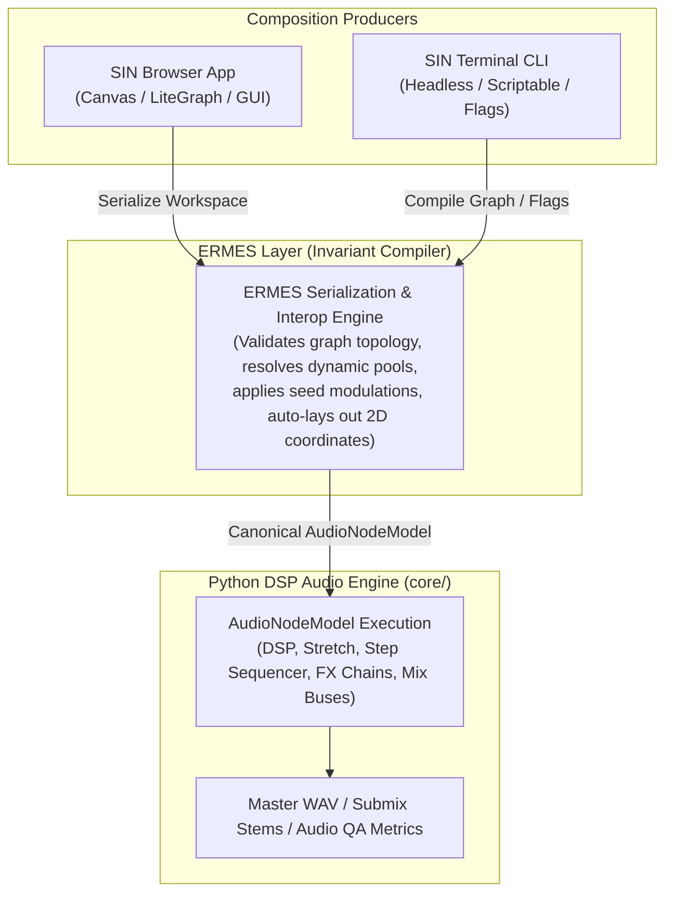

# SIN & GAIA Agent Workflow & Architecture Guide

> **Authoritative Agent Memory & Instruction Set**  
> Consolidates all system roles, ERMES translation contracts, GAIA library rules, the 4-command CLI, and composition recipes into a single reference.

---

## 1. System Role & Architecture

SIN separates composition, compilation, and sound generation into three distinct layers:

1. **Python Audio Engine (`core/`):**
   Executes the canonical `AudioNodeModel` payload tree. Responsible for all DSP operations, Rubber Band time-stretching, step sequencer timing, FX modules (gain, compressor, saturation, eq), multi-bus audio summing, and final WAV generation.
2. **ERMES Translation Layer (`ermes/`):**
   The invariant serialization and compilation engine. Bridges compositional definitions (declarative `sin-graph` documents, LiteGraph workspace presets, asset pool locators, and random modulation seeds) into the normalized `AudioNodeModel` execution tree for the audio engine.
3. **Decoupled Producers:**
   - **Browser SIN App (`editor/`):** Canvas-based visual interface for human wire connecting and live auditioning.
   - **SIN Terminal CLI (`cli.py`):** Headless, scriptable producer designed for agents and non-interactive batch runs.



---

## 2. Shared Presets & The Coordinate Solution

- **The Problem:** The terminal CLI and agents operate on pure logical topology without caring about 2D screen coordinates (`[x, y]`), while the browser LiteGraph canvas strictly requires coordinates to render without overlapping.
- **The Solution:** Canonical `sin-graph` files (`format: "sin-graph"`) store **pure topological connectivity**; node `position: [x, y]` is strictly **optional**.
- **Auto-Layout Engine (`compute_auto_layout_positions`):**
  When a preset is loaded in the browser or converted via `sin compose convert <path> --to workspace`, ERMES automatically assigns non-overlapping coordinates based on audio signal flow:
  - **Column 1 (x=320):** Source nodes (`sample`)
  - **Column 2 (x=600):** Processors (`sequence`, `arrangement`)
  - **Column 3 (x=880):** Submix buses (`track`, e.g., Drum Bus, 808 Bass Bus)
  - **Column 4 (x=1160):** Master output track
  - **Modifiers (x = owner_x - 220):** `asset_filter`, `random`, and `modulator` nodes are placed directly to the left of their owner node.

---

## 3. Minimal 4-Command Headless CLI

The CLI provides full functional parity with the browser application via **4 major commands**:

```text
sin
├── serve                # Local dev server & API daemon
├── render [SOURCE]      # Headless audio DSP render & audition
├── compose              # Headless patch validation, inspection & conversion
└── library              # Headless read-only GAIA discovery and verification
```

### 3.1 `sin serve`
- Starts the local API server on `http://127.0.0.1:8000`.
- Flags: `--host`, `--port`, `--reload/--no-reload`, `--debug/--no-debug`.

### 3.2 `sin render [SOURCE]`
- Renders graph or preset to audio (defaults to `saves/.current-stage.json` if omitted).
- Flags:
  - `--out <path>`: Output WAV destination path (default: `output.wav`).
  - `--mode <offline|preview>`: Full DSP offline render vs fast preview.
  - `--seed <float>`: Deterministic random seed override for pools/randomizers.
  - `--reroll <scope>`: Re-roll scope: `global` (default), `pools`, `patterns`, `none`.
  - `--bpm <float>` / `--key <str>` / `--bars <float>`: Musical overrides.
  - `--isolate <node_id>`: Solo/isolate a specific bus or node (e.g. `--isolate "808-bass-bus"`).
  - `--stems`: Export individual stem WAV files for each child bus.
  - `--qa`: Calculate automated audio QA verification (peak dB, RMS dB, clipping count, duration).
  - `--json`: Output machine-readable JSON summary for agents.
  - `--dry-run`: Validate and compile graph without running DSP.

### 3.3 `sin compose`
- `validate <path> [--strict] [--json]`: Strict canonical schema and topology validation.
- `info <path> [--json]`: Summarizes format, BPM, bars, key, node breakdown, and duration.
- `compile <path> [--out] [--isolate]`: Compiles graph directly to canonical `AudioNodeModel` JSON.
- `convert <path> --to workspace|canonical [--out]`: Bidirectional conversion applying auto-layout.

### 3.4 `sin library`
- `search [--vault] [--type] [--tag] [--bpm-min] [--bpm-max] [--key] [--limit] [--json]`: Query GAIA assets.
- `verify <path> [--json]`: Verifies all asset IDs and paths referenced in a graph exist on disk.

---

## 4. GAIA Library Ownership & Read-Only Boundaries

1. **Sole Manager Authority:** GAIA is the sole library-management application. It owns asset indexing, physical storage under `assets/vaults/<storage_key>/`, and `gaia.db`.
2. **SIN Read-Only Rule:** SIN is strictly a read-only consumer. SIN never creates, deletes, moves, renames, tags, or modifies files in GAIA.
3. **Folders as Logical Bins:** Folders anywhere in GAIA are purely logical organizational bins. Moving or deleting folders never touches files on disk.
4. **Metadata Proposals:** If SIN needs to propose metadata changes (BPM, key, favourite), it must submit a proposal via `POST http://127.0.0.1:8001/sin-proposals/` using `SinMetadataProposalCreate`:
   ```json
   {
     "asset_ref": "352",
     "absolute_path": "C:/web-projects/sin/assets/vaults/default-vault/samples/Kick.wav",
     "field": "bpm",
     "proposed_value": 128.0,
     "previous_value": 120.0,
     "source_node_id": 12
   }
   ```

---

## 5. Composition Contracts for Hip-Hop Drums & Bass

### 5.1 Dual-Bus Mixing Architecture
Always route rhythm sections through dedicated submix buses before the master track:
- **Punch Drum Bus (`Audio/Track`):** Sums kicks, snares/claps, hi-hats, percs/cowbells with drum bus compression and tape saturation.
- **Sub / 808 Bass Bus (`Audio/Track`):** Sums bass and sub-bass lines with low-end EQ sculpting and warm saturation.
- **Master Output Track (`role: "master"`):** Clean summing of Drum Bus + Bass Bus with master gain calibrated between `-2.0 dB` and `-3.5 dB` to guarantee peak levels stay below 0 dBFS.

### 5.2 Canonical Schema Blueprint

```json
{
  "format": "sin-graph",
  "version": 1,
  "settings": { "bpm": 140, "total_bars": 16, "key": "Fm" },
  "output": "master",
  "nodes": [
    {
      "id": "kick-pool",
      "type": "asset_filter",
      "properties": {
        "node_name": "Punch Kick Pool",
        "selected_items": [{ "id": 352 }, { "id": 353 }, { "id": 354 }],
        "playbackMode": "Random",
        "refresh_mode": "global"
      }
    },
    {
      "id": "kick-sample",
      "type": "sample",
      "properties": { "node_name": "Kick", "sample_type": "one_shot" }
    },
    {
      "id": "kick-seq",
      "type": "sequence",
      "properties": {
        "node_name": "Kick Rhythm",
        "sequence": [1,0,0,0,0,0,1,0,0,0,1,0,0,0,0,0],
        "step_parameters": [
          { "probability": 100, "offset": 0.0, "velocity": 1.0, "subdivisions": 1, "subdivision_enabled": false }
        ],
        "step_length": 0.25,
        "play_mode": "trigger"
      }
    },
    { "id": "drum-bus", "type": "track", "properties": { "node_name": "Drum Bus", "mix_mode": "sum" } },
    { "id": "master", "type": "track", "role": "master", "properties": { "node_name": "Master Output", "gain": -3.0 } }
  ],
  "connections": [
    { "from": "kick-sample", "to": "kick-seq", "type": "audio" },
    { "from": "kick-seq", "to": "drum-bus", "type": "audio" },
    { "from": "drum-bus", "to": "master", "type": "audio" }
  ],
  "attachments": [
    { "owner": "kick-sample", "modifier": "kick-pool", "type": "asset_pool" }
  ]
}
```

### 5.3 Micro-Timing & Humanization Rules
- **Lazy Snare / Clap:** Apply small positive micro-timing offsets (`offset: +0.015` to `+0.025` beats, ~15-25ms) to backbeat snares for authentic hip-hop swing.
- **Swung Hi-Hats / Shakers:** Off-beat 16th hats receive positive offsets (`offset: +0.02` to `+0.03`) and lower velocity (`velocity: 0.5` to `0.7`).
- **Turnaround Rolls:** Enable subdivisions (`subdivisions: 2` or `3`, `subdivision_enabled: true`) on step 15 or 16 for turnaround fills.

---

## 6. End-to-End Production & Verification Workflow

When authoring or modifying a preset:
1. **Search Assets:** Use `sin library search --tag <Tag> --limit <N> --json` to gather exact asset IDs from `gaia.db`.
2. **Draft Graph:** Construct the canonical `sin-graph` JSON under `presets/drums/<name>.json`.
3. **Validate Topology:** Run `sin compose validate presets/drums/<name>.json --json`.
4. **Verify Locators:** Run `sin library verify presets/drums/<name>.json --json` to ensure 100% of referenced files exist on disk.
5. **Convert for Browser:** Run `sin compose convert presets/drums/<name>.json --to workspace --out saves/<name>.json` to apply auto-layout.
6. **DSP Render & QA:** Run `sin render presets/drums/<name>.json --qa --out temp_renders/<name>.wav` to verify duration, peak level (< 0 dBFS), and silence checks.

---

## 7. Fast & Reliable Test Execution

The test suite is tiered to prevent friction during agent runs:
- `python tests/run.py` (or `npm run test:quick`): Fast unit tier (~25s). Skips slow 1,000+ item database batching & deletion stress tests.
- `python tests/run.py --changed` (or `npm run test:changed`): Targets only the test suites affected by modified files via git status.
- `python tests/run.py cli` (or `npm run test:cli`): Fast verification of CLI commands, preset QA, and warning checks (~0.5s).
- `python tests/run.py full` (or `npm run test:full`): Full suite including scale stress tests and integration tests (~55s). Run before releases or major refactors.
- `npm test`: Runs fast Python suite followed by frontend node tests.

