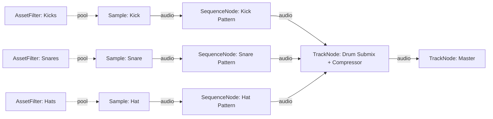
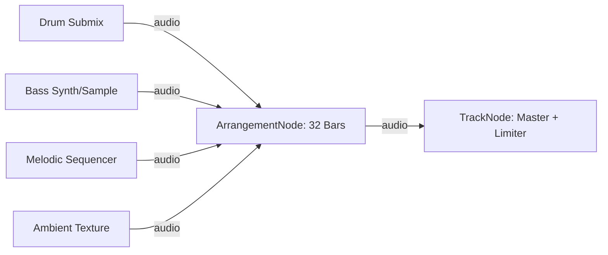

# SIN Editor Composition Guide & Agent Memory

This document is the authoritative guide and memory for authoring, analyzing, and structuring musical compositions using the **SIN node editor**.

---

## 1. Composition Philosophy & Mental Model

In SIN, a musical composition is represented as an **audio execution graph** (a Directed Acyclic Graph, or DAG):

1. **Sound Generators & Sources**: Raw sound units (`SampleNode`), which either reference concrete GAIA assets or bind to dynamic asset pools (`AssetFilterNode`).
2. **Musical Event Patterning**: Rhythmic and melodic structures governed by step sequencers (`SequenceNode`) controlling triggers, pitch offsets, velocities, gates, and per-step probabilities.
3. **Macro Structural Arrangement**: Time-axis structuring governed by `ArrangementNode`, organizing loop blocks and pattern stems into sections (Intro, Verse, Drop, Break, Outro) across musical bars.
4. **Mix Bus Architecture & Signal Processing**: Channel routing, volume staging, panning, and DSP effects chains (EQ, Compressor, Saturation, Reverb) housed inside `TrackNode` instances.
5. **Master Culmination**: Every valid composition graph converges to exactly one master track (`TrackNode` with `"role": "master"`).
6. **Execution & Rendering**: The graph is traversed by **ERMES** from the master output back to upstream sources, resolves dynamic pools/seeds against GAIA, serializes to canonical `AudioNodeModel` JSON, and processes through the SIN DSP engine into a RAM preview buffer or final rendered WAV file.

### 1.1 Streamlined Preset Creation & Editing Policy
- **Fast & Direct**: Unless explicitly instructed otherwise by the user, preset creation and editing should be streamlined, fast, and performed directly on JSON presets (`demo/.../*.json` and `saves/*.json`) using existing tools without modifying application code.
- **No Build / Full Test Overhead**: Do not run `npm run build:editor`, full frontend test suites, or full backend test suites during preset creation. SIN's infrastructure is already developed and validated.
- **Code Issues Reporting**: If testing or creating reveals any code bugs or engine defects:
  1. Record the defect in [`.agents/notifications.md`](file:///c:/web-projects/sin/.agents/notifications.md).
  2. Clearly report it to the user in the response.
- **Drums Compaction**: In minimal hip-hop/cloud arrangements, favor compacting all rhythmic elements (Kick, Snare, Hi-Hat, 808, Percs) into a **single drum submix track** that merges into the master, while keeping the main atmospheric sample loop on its own dedicated channel.

---

## 2. Complete Node Catalog

### 2.1 `SampleNode` (`Audio/Sample`)
The fundamental sound generator. It loads and processes individual audio samples or loops.

- **Class**: Subclass of `BaseNode` (`editor/src/nodes/SampleNode.ts`).
- **Pins**:
  - Inputs: Modifier input (for attached `AssetFilterNode` pool or modulators).
  - Outputs: `audio` (stereo audio stream).
- **Key Properties**:
  | Property | Type | Description |
  | :--- | :--- | :--- |
  | `sample` | `string` | File path of the audio file (resolved from GAIA asset). |
  | `sample_type` | `string` | Either `"loop"` or `"one_shot"` (required by canonical schema). |
  | `bpm` | `number` | Playback/target tempo in BPM. |
  | `original_bpm` | `number` | Inherent tempo of the raw sample detected by GAIA. |
  | `key` | `string` | Musical key root (e.g. `"C"`, `"F#m"`). |
  | `stretch_mode` | `string` | Stretch engine algorithm: `"RubberBand"`, `"RubberBandPercussive"`, `"Resample"`, `"Fast"`. |
  | `transpose` | `number` | Pitch shift in semitones (-24 to +24). |
  | `cents` | `number` | Fine pitch tuning in cents (-100 to +100). |
  | `crop_start` | `number` | Relative start point offset (0.0 to 1.0). |
  | `crop_end` | `number` | Relative end point (0.0 to 1.0). |
  | `fade_in` | `number` | Linear fade-in duration in seconds. |
  | `fade_out` | `number` | Linear fade-out duration in seconds. |
  | `gain` | `number` | Node output gain in dB (-60 to +12 dB) or normalized scalar. |
  | `reverse` | `boolean` | Play sample in reverse when `true`. |
  | `is_loop` | `boolean` | Loop playback toggle. |
  | `key_match_mode` | `string` | Key matching mode: `'off'` (default), `'follow'` (matches project key), `'lead'`. |
  | `key_match_algorithm` | `string` | Tempo/pitch shift algorithm: `'nearest'` (auto, minimizes octave divergence), `'higher'` (shift up / double tempo), `'lower'` (shift down / halve tempo). |

### 2.2 `SequenceNode` (`Audio/Sequence`)
The rhythmic and melodic pattern generator.

- **Class**: Subclass of `BaseNode` (`editor/src/nodes/SequenceNode.ts`).
- **Pins**:
  - Inputs: `audio` (source sample to trigger/sequence) + modifier input.
  - Outputs: `audio` (sequenced audio pattern).
- **Key Properties**:
  | Property | Type | Description |
  | :--- | :--- | :--- |
  | `step_count` | `number` | Total steps in pattern (typically 8, 16, 32). |
  | `step_length` | `number` | Duration of each step in musical beats (e.g. 0.25 for 16th notes, 0.5 for 8th notes, 1.0 for quarter notes). |
  | `beats_per_bar` | `number` | Time signature numerator (default: 4). |
  | `swing` | `number` | Groove / swing ratio (0.0 = straight, 0.5 = heavy swing). |
  | `steps` | `Array` | Array of per-step parameter objects. |
- **Step Object Schema**:
  ```json
  {
    "active": true,
    "velocity": 100,
    "pitch_offset": 0,
    "duration": 0.25,
    "probability": 1.0
  }
  ```
  - `active` (`boolean`): Whether this step triggers.
  - `velocity` (`number`): Trigger velocity (0 to 127). Modulates amplitude.
  - `pitch_offset` (`number`): Melodic pitch offset in semitones (-24 to +24).
  - `duration` (`number`): Gate duration fraction before release.
  - `probability` (`number`): Likelihood of trigger (0.0 to 1.0) evaluated by ERMES random seed.

### 2.3 `ArrangementNode` (`Audio/Arrangement`)
The structural timeline organizer. Takes child audio objects (loops, samples, sequences) and repeats them to fill bars and sections.

- **Class**: Subclass of `BaseNode` (`editor/src/nodes/ArrangementNode.ts`).
- **Pins**:
  - Inputs: `audio` input(s) for song stems or loops.
  - Outputs: `audio` (arranged master timeline mix).
- **Key Properties**:
  | Property | Type | Description |
  | :--- | :--- | :--- |
  | `total_bars` | `number` | Total duration of the arrangement in bars (default: 4.0, e.g. 8, 16, 32). |
  | `section_points` | `number[]` | Cut markers in bars dividing the timeline into sections (e.g. `[4.0]` creates two 4-bar sections). |
  | `section_probability` | `number[]` | Playback probability per section (0.0 to 1.0). |
  | `section_sample_start` | `number[]` | Normalized source offset fraction per section (0.0 to 1.0). |
  | `section_quant` | `string[]` | Retrigger / repetition interval per section: `"auto"` (Continuous loop repetition at source length, default), `"bar"` (1 bar), `"0.5"` (half bar), `"beat"` (quarter bar), `"none"` / `"once"` (single trigger). |
  | `section_quant_anchor` | `string[]` | Trigger alignment per section: `"start"` (align to cell start) or `"end"` (align to cell end). |
  | `seed` | `number` | Deterministic random seed for probability gates. |

### 2.4 `TrackNode` (`Audio/Track`)
Channel strip, submix bus, and final master output mixer.

- **Class**: Subclass of `BaseNode` (`editor/src/nodes/TrackNode.ts`).
- **Pins**:
  - Inputs: `audio` inputs from upstream generators or arrangement nodes.
  - Outputs: `audio` to downstream submix or master.
- **Key Properties**:
  | Property | Type | Description |
  | :--- | :--- | :--- |
  | `role` | `string` | `"track"`, `"submix"`, or `"master"`. Exactly one master required per graph. |
  | `volume` | `number` | Track fader gain in dB (-60 to +6 dB). |
  | `pan` | `number` | Stereo panning (-1.0 left to +1.0 right, 0.0 center). |
  | `mute` | `boolean` | Mute state. |
  | `solo` | `boolean` | Solo state. |
  | `fx_modules` | `Array` | Ordered chain of DSP effect modules. |
- **FX Module Types**:
  - **Equalizer (`eq`)**:
    - `low_gain_db`, `low_freq_hz`
    - `mid_gain_db`, `mid_freq_hz`
    - `high_gain_db`, `high_freq_hz`
  - **Compressor (`compressor`)**:
    - `threshold_db` (-40 to 0)
    - `ratio` (1.0 to 20.0)
    - `attack_ms`, `release_ms`
  - **Saturation (`saturation`)**:
    - `drive` (0.0 to 1.0)
    - `color` (warmth / tone)
  - **Reverb (`reverb`)**:
    - `room_size` (0.0 to 1.0)
    - `decay` (seconds)
    - `damping` (0.0 to 1.0)
    - `wet_level`, `dry_level`

### 2.5 `AssetFilterNode` (`Audio/AssetFilter`)
Dynamic and generative asset pool modifier attached via an **ownership attachment** (not an audio wire) to a `SampleNode` or `SequenceNode`.

- **Key Properties**:
  | Property | Type | Description |
  | :--- | :--- | :--- |
  | `selected_items` | `Array` | List of exact GAIA asset IDs: `[{"id": 352}, {"id": 1024}]`. |
  | `playbackMode` | `string` | Selection policy: `"Sequential"`, `"Random"`, or `"Fixed"`. |
  | `refresh_mode` | `string` | Reroll timing: `'global'` (default - rerolls on global preview/render), `'parent'`, `'ancestor'`, `'local'`, `'off'`. |
  | `seed` | `number` | Integer seed for deterministic random selection. |
  | `fixed_item` | `object` | The pinned locator `{ "id": 352 }` when in `'off'` or fixed mode. |

- **Refresh Mode Behavior**:
  - `local`: Rerolls whenever this specific node is rendered or refreshed.
  - `parent`: Rerolls when parent sequencer or arrangement triggers a new bar/cycle.
  - `global`: Rerolls only on global composition refresh / reroll request.
  - `off`: Never rerolls; pins the locator in `fixed_item`.

### 2.6 `RandomNode` (`Audio/Random`)
Dynamic parameter modifier attached to a target node (e.g. `SequenceNode` or `SampleNode`) to continuously humanize or randomize parameters across preview runs.
- **Attachment**: Attached via ownership reference (`parentId: targetNodeId`).
- **Destinations & Sequence Step Modulation**:
  - Direct properties (e.g. `pitch`, `pan`, `cutoff`).
  - Sequence step parameter arrays: targeting `'velocity'`, `'offset'`, `'probability'`, or `'subdivisions'` humanizes all steps across the parent sequence pattern.
- **Key Properties**:
  - `destinations`: Target parameter keys (e.g. `[{ "paramKey": "velocity", "minPercent": -18, "maxPercent": 18 }]`).
  - `refresh_mode`: `'global'` (default), `'parent'`, or `'local'`.
  - `seed`: Deterministic random seed.

### 2.7 `DisabledNode` (`Audio/Disabled`)
Placeholder / bypass node. Upstream branches connected to a disabled node are pruned during ERMES subtree traversal.

---

## 3. Composition Topologies

### Topology 1: Direct Sample Loop
Simplest topology. One audio loop stretched to target BPM feeding the master track.


### Topology 2: Generative Rhythmic Drum Machine
Three samples (Kick, Snare, Hi-Hat) with asset pools attached to cycle through kits, sequenced via three step sequencers, grouped into a drum submix track, and routed to master.


### Topology 3: Full Song Arrangement
Stems and instruments feeding an `ArrangementNode` with defined section boundaries, routed through submix tracks to master.


---

## 4. Canonical Graph Schema (`sin-graph`)

When generating or authoring compositions programmatically, use the **canonical graph schema**:

```json
{
  "format": "sin-graph",
  "version": 1,
  "settings": {
    "bpm": 128,
    "total_bars": 8,
    "key": "Am"
  },
  "nodes": [
    {
      "id": "kick-src",
      "type": "sample",
      "properties": {
        "sample_type": "one_shot",
        "gain": 0.0
      }
    },
    {
      "id": "kick-pool",
      "type": "asset_filter",
      "properties": {
        "selected_items": [{ "id": 101 }, { "id": 102 }, { "id": 103 }],
        "playbackMode": "Random",
        "refresh_mode": "parent",
        "seed": 42
      }
    },
    {
      "id": "kick-seq",
      "type": "sequence",
      "properties": {
        "step_count": 16,
        "step_length": 0.25,
        "beats_per_bar": 4,
        "steps": [
          { "active": true, "velocity": 120, "pitch_offset": 0, "probability": 1.0 },
          { "active": false },
          { "active": false },
          { "active": false },
          { "active": true, "velocity": 110, "pitch_offset": 0, "probability": 1.0 },
          { "active": false },
          { "active": false },
          { "active": false },
          { "active": true, "velocity": 115, "pitch_offset": 0, "probability": 1.0 },
          { "active": false },
          { "active": false },
          { "active": false },
          { "active": true, "velocity": 110, "pitch_offset": 0, "probability": 1.0 },
          { "active": false },
          { "active": false },
          { "active": false }
        ]
      }
    },
    {
      "id": "drum-bus",
      "type": "track",
      "properties": {
        "role": "track",
        "volume": -2.0,
        "pan": 0.0
      }
    },
    {
      "id": "master-out",
      "type": "track",
      "role": "master",
      "properties": {
        "role": "master",
        "volume": 0.0
      }
    }
  ],
  "connections": [
    { "owner": "kick-src", "modifier": "kick-pool", "type": "asset_pool" },
    { "from": "kick-src", "to": "kick-seq", "type": "audio" },
    { "from": "kick-seq", "to": "drum-bus", "type": "audio" },
    { "from": "drum-bus", "to": "master-out", "type": "audio" }
  ],
  "output": "master-out"
}
```

### Schema Rules & Validation Contracts:
1. `format` must be `"sin-graph"`, `version` must be `1`.
2. `settings` must declare `bpm`, `total_bars`, and `key`.
3. Node `id` strings must be unique within the document.
4. `sample` nodes must specify `sample_type` as `"loop"` or `"one_shot"`.
5. Connections must specify `from` and `to` (for audio routing) or `owner` and `modifier` (for asset pool attachments).
6. Audio connections must not form directed cycles.
7. Exactly one node must have role `master`, referenced by `output`.

### 4.1 Node Spatial Placement & Canvas 2D Layout Rules:
When laying out nodes on the canvas or writing canonical graph documents, follow the **5-Column DAG Grid**:
- **Column 0 (`x = 80`)**: Modifiers & Asset Pools (`AssetFilterNode`, `ModulatorNode`). Placed directly to the left of their owner node.
- **Column 1 (`x = 320`)**: Audio Generators & Sources (`SampleNode`).
- **Column 2 (`x = 600`)**: Pattern & Arrangement Processors (`SequenceNode`, `ArrangementNode`).
- **Column 3 (`x = 900`)**: Submix & Stems Buses (`TrackNode`).
- **Column 4 (`x = 1200`)**: Master Output (`TrackNode` with `role: "master"`).

**Vertical Lane Spacing**:
- Each instrument stem (e.g. Atmosphere, 808 Sub, Kick, Snare/Clap, Hi-Hat, FX) occupies its own distinct horizontal lane spaced by `row_spacing = 160px` (`y = 100, 260, 420, 580, 740, 900...`).
- Submix tracks are vertically centered across their input stems (e.g. `drum-bus` centered across Kick, Snare, Hat).
- Master output is centered across the overall graph.
- Never place nodes in a flat 1D horizontal line (`y = 180` across all nodes); always use this 2D grid. The automatic topological layout algorithm (`computeAutoLayoutPositions` in `ermes/ts/graphSchema.ts`) uses this contract if coordinates are omitted.

---

## 5. Composition Execution & Rendering Flow

1. **Step 1: Stage Persistence**
   - Save stage JSON to `saves/.current-stage.json` via `POST /api/stage/save` (`StageSaveRequest`).
2. **Step 2: Subtree Traversal (ERMES)**
   - Starting at the master output node, recursively visit connected upstream pins. Prune disabled nodes.
3. **Step 3: Dynamic Asset & Seed Resolution**
   - For attached `AssetFilterNode` modifiers, query GAIA database using the item IDs in `selected_items`.
   - Resolve absolute sample paths, native sample BPM, sample rate, and channel layouts.
   - For `RandomNode` modifiers, calculate current randomized parameter values clamped to schema boundaries.
4. **Step 4: Serialization to Canonical AudioNodeModel**
   - ERMES produces a canonical Pydantic model (`AudioNodeModel`) with nested child nodes, connections, and FX modules.
5. **Step 5: DSP Engine Execution**
   - Send payload to `POST /api/render` or `POST /api/preview/ram`.
   - The DSP engine loads audio buffers via `soundfile`/`scipy`, applies Rubber Band pitch-shifting/time-stretching according to target BPM and key, executes step sequencing triggers, sums audio buses, and runs FX algorithms.
6. **Step 6: Auditioning & Export**
   - Stream audio from memory via `GET /api/preview/ram/{preview_id}`.
   - Export rendered master to WAV file via `POST /api/preview/ram/{preview_id}/export`.

---

## 6. Prototyping Recipes for Agents

### Recipe 1: 4-Bar Lo-Fi Drum Beat with Dynamic Kit Cycling
- Target: 85 BPM, Key: C, 4 Bars.
- Topology: Kick, Snare, Hi-Hat sources -> 3 `AssetFilterNode` pools with `playbackMode: "Random"`, `refresh_mode: "parent"` -> 3 `SequenceNode` 16-step patterns -> `TrackNode` with subtle saturation and compressor -> Master.

### Recipe 2: Melodic Arpeggio with Probability Gate
- Target: 120 BPM, Key: Em, 8 Bars.
- Topology: Single synthesizer/acoustic plucks `SampleNode` (one-shot) -> `SequenceNode` (16 steps with scale notes `[0, 3, 7, 10, 12]`, probability 0.85 on accented beats, 0.4 on ghost notes) -> `TrackNode` with Reverb (`room_size: 0.7`, `decay: 2.5s`, `wet_level: 0.35`) -> Master.

### Recipe 3: Ambient Generative Soundscape
- Target: 65 BPM, Key: Dm, 16 Bars.
- Topology: 2 Loop `SampleNode` textures -> 2 `AssetFilterNode` pools with `playbackMode: "Sequential"`, `refresh_mode: "local"` -> `RandomNode` modulating transpose between -5 and +7 semitones -> `ArrangementNode` (crossfading 8-bar sections) -> Master.

### Recipe 4: Ronald's Minimal Abstract Hip-Hop (Cloud / Vapor)
- Target: 74–84 BPM (half-time), Key: Minor (Am, Dm, Em), 16 Bars continuous loop.
- Producer Persona: See [`.agents/memory/ronald-producer-guide.md`](file:///c:/web-projects/sin/.agents/memory/ronald-producer-guide.md) and [`demo/ronald/branding.md`](file:///c:/web-projects/sin/demo/ronald/branding.md).
- Topology: Living noise floor/perc pool (-16 dB) + Ethereal vocal/pad pool (wet hall reverb) + Sub 808 pool + Punchy soul kick + Beat 2 & 4 anchor snare/clap pool -> Drum bus compressor + Master output.
- Reference Implementations: [`demo/ronald/system_1_cloud_drift.json`](file:///c:/web-projects/sin/demo/ronald/system_1_cloud_drift.json), [`demo/ronald/system_2_tape_haze.json`](file:///c:/web-projects/sin/demo/ronald/system_2_tape_haze.json), and [`demo/ronald/system_3_celestial_drip.json`](file:///c:/web-projects/sin/demo/ronald/system_3_celestial_drip.json).

### Recipe 5: Drum Movement & Pocket Engineering
When programming drum sequences in SIN, avoid mechanical, flat velocities and zero offsets:
1. **Lazy Snare Pocket**: Shift snares and claps by `offset: +0.02` to `+0.035` beats (~15–25 ms late) to lay back into the groove behind the grid.
2. **Ghost Snares**: Place quiet ghost hits (`velocity: 0.32` - `0.40`, `probability: 85-90%`) on turnaround 16th steps (steps 7, 14, or 15).
3. **Hi-Hat Velocity Arcs**: Alternate downbeats (`0.90 - 0.95`) with quiet offbeats (`0.38 - 0.45`) and apply micro-timing swing (`offset: +0.024` to `+0.032` on even 16ths).
4. **Subdivision Rolls**: Trigger fast 32nd-note (`subdivisions: 2`) or triplet (`subdivisions: 3`) rolls on turnaround steps (step 14 or 15).
5. **Syncopated Kick Bounce**: Anchor downbeat on step 0, and push offbeats on step 10 (`offset: -0.015`) to leave space for 808 sub decay.
6. **Pool Policy**: Use `refresh_mode: "global"` so hitting global preview re-rolls every pool in harmony.
