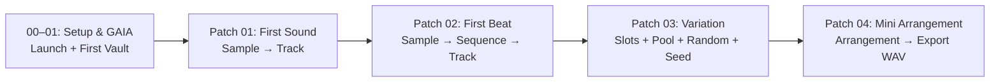

# Beginner First Start Guide

<!-- Outline scaffold — Phase 2 fills full prose and companion patches -->

A short, hands-on workshop taking you from launching SIN + GAIA to building beat variations and a mini arrangement in ~15 minutes.

- **Hybrid asset workflow**: Lesson `01` shows how to set up a starter vault in **GAIA** and browse it inside SIN (`L`), while all companion patches (`01`–`04`, added in Phase 2) also let you load or drop local audio samples directly onto SIN nodes even without an active GAIA connection.
- **Format**: Each patch lesson follows one repeatable flow — **Open & Play → Read the Graph → Hands-On Tweaks → Try It Yourself**.

---

## Learning Path

| # | Lesson | Companion Patch | Core Concepts |
| :--- | :--- | :--- | :--- |
| `00` | [Launch & Mental Model](./00-mental-model.md) | — | Launching SIN & GAIA, two-app boundary, left-to-right signal flow, core shortcuts |
| `01` | [First Vault in GAIA](./01-first-vault-in-gaia.md) | — | Creating/selecting a vault, importing starter or local audio, previewing, Library panel (`L`), standalone local-sample option |
| `02` | [First Sound](./02-first-sound.md) | `01_first_sound.json` *(Phase 2)* | `Sample` → `Track`, `Space` transport, Loop mode, BPM/Key sync, waveform crop |
| `03` | [First Beat](./03-first-beat.md) | `02_first_beat.json` *(Phase 2)* | `Sample` (`One Shot`), `Sequence` 16-step grid, velocity/offset/probability/subdivisions, `CHAIN` Gain Staging & `Track` mixing |
| `04` | [Slots, Pools & Variation](./04-slots-pools-and-variation.md) | `03_slots_and_variation.json` *(Phase 2)* | Multi-slots `[0][1]`, `Asset Pool`, `Random`, Global Seed, Refresh (`↻`), Lock, Freeze, Field Operators |
| `05` | [Arranging & Exporting](./05-arranging-and-exporting.md) | `04_mini_arrangement.json` *(Phase 2)* | `Arrangement` sections (`Slot`, `Quantize`, `Anchor`, `Probability`), `EXPORT` tab, `Render` menu, Save & Download WAV |

---

## Patch Progression

---

## Companion Patches & Next Steps

- **Patch Directory & Loader Rules**: [patches/README.md](./patches/README.md)
- **Go Deeper in GAIA**: [GAIA Library Guide](../gaia/README.md)
- **Go Deeper in SIN**: [SIN Node Editor Reference](../sin/README.md)
- **Back to Home**: [Documentation Index](../README.md)
